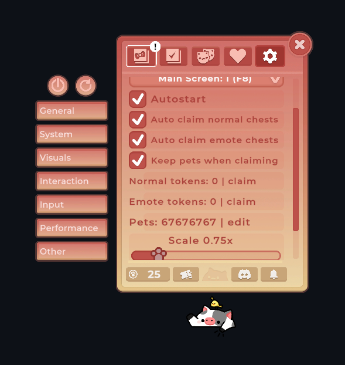
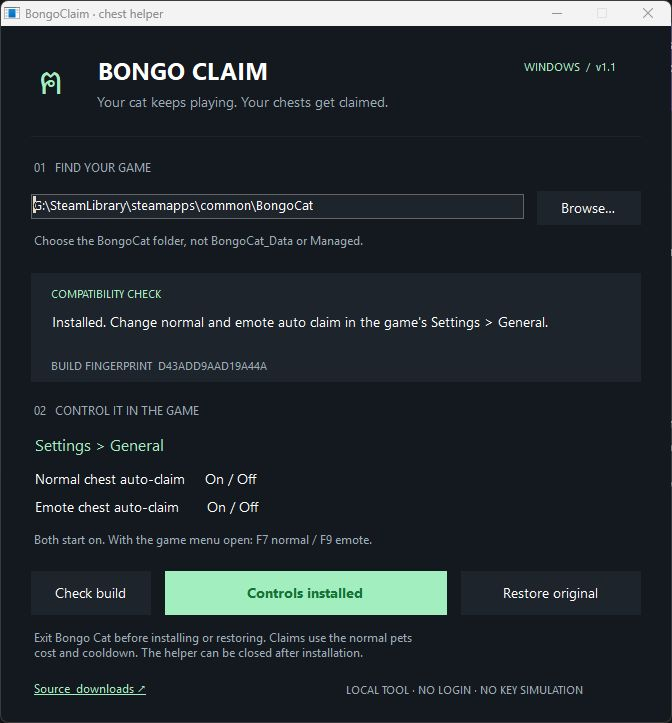

# BongoClaim ฅ

**Auto-claim normal and emote chests, open stored chest tokens, and control your pet score in Bongo Cat.** Install the Windows helper once, then launch Bongo Cat normally through Steam.

[Download the portable ZIP](https://github.com/NH4OH-35/bongo-claim/releases/latest) · [Report a problem](https://github.com/NH4OH-35/bongo-claim/issues)



The screenshot shows the v1.1 auto-claim switches. v1.2 adds stored-token buttons, **Keep pets when claiming**, and **Edit pet score** in the same General panel.

## Everyday use

**Already installed? Just start Bongo Cat normally from Steam.** All controls run inside the game; you can leave `BongoClaim.exe` closed. Keep Bongo Cat and Steam running. Normal and emote auto-claim use their existing timer. By default, claims still cost pets.

Open the game menu with **Escape** or **M**, click the **gear**, then choose **General**. Check **Auto claim normal chests** or **Auto claim emote chests** to enable that type; uncheck it to pause. Each choice takes effect while playing and saves for the next launch. Both start enabled. A request already sent to the server can still finish after switching off.

For quick control with the game menu open, press **F7** for normal or **F9** for emote. **Shift + F9** also works for emote if plain F9 is intercepted or missed. Shortcuts work only while the game is focused and no text field is active. They update the same saved switches and checkmarks.

Other menu shortcuts: **F5** toggles Keep pets, **F10** edits your pet score, **F11** opens one owned normal token, and **Insert** opens one owned emote token. Toggle and token shortcuts pause while you are editing a score.

### Stored tokens and manual claims

In **Settings → General**, the **Normal tokens: N | claim** and **Emote tokens: N | claim** rows show quantities from your Steam inventory. Click a row to open **one** owned token of that type. After it finishes, click again for another. These buttons work during the local countdown and independently of the auto-claim switches.

Empty or loading rows cannot be clicked. The game must have the other exchange inputs it requires, sufficient pets unless **Keep pets** is enabled, and no pending request. Steam still decides whether the exchange succeeds. The buttons do not create tokens or change their server drop schedule. The game's normal successful or failed claim cooldown is retained.

### Keep pets when claiming

Enable **Keep pets when claiming** to open your normal and emote chests without deducting pets, including claims made through the original chest buttons. It starts **off** and saves separately from both auto-claim switches. Turning it off restores the normal pets price. Owned inventory tokens are consumed either way. A request already in progress uses the price choice captured when it started; gifting keeps its original spending rules.

### Edit available pet score

Click **Pets: N | edit** or press **F10** with the game menu open. Type the desired nonnegative whole number using the number row or numpad, then press **Enter** to save. **Backspace** deletes; **Escape** cancels. Clicking the editor again or closing the menu also cancels.

This changes your **available pets** and saves through the game's Steam stats API. It preserves lifetime achievement taps and total pets previously spent. Values that would overflow the game's counter are rejected; the maximum is `2,147,483,646 − total spent`. Score editing does not grant inventory tokens or server eligibility. Restoring the game DLL removes these controls; it does not undo a score you explicitly saved.

## First-time installation

1. Download `BongoClaim-v1.2.0-windows.zip` from Releases and **extract the whole ZIP**.
2. Exit Bongo Cat normally.
3. Open `BongoClaim.exe`. Keep `Mono.Cecil.dll` beside it.
4. The app finds your running game or Steam library. If needed, browse to the folder containing `BongoCat.exe`.
5. Click **Check build**, then **Install auto claim** (or **Upgrade controls** for v1.0/v1.1).
6. Start Bongo Cat from Steam. The patch works inside the game; this helper does not need to stay open.



Changes to the saved switches do not require reinstalling or keeping BongoClaim open. Upgrades rebuild the patch from your verified original backup and retain that same original for restoration. Existing normal and emote preferences are preserved.

Auto-claim calls the game's existing `ShopItem.Buy()` when a chest is ready. Manual stored-token claims also call `Buy()`, after checking owned inventory inputs and pending-request guards. The optional **Keep pets** switch changes the captured local price flag; the optional score editor changes only the available-pets counter through the game. No keyboard presses, Steam token grants or changes to the server drop schedule are generated.

## Why the old DLL stopped being suitable

The archived [Bongo-Cat-Auto-Claim](https://github.com/zelda0079/Bongo-Cat-Auto-Claim) ships an entire older `Assembly-CSharp.dll`. The inspected July version inserted a purchase into a generated timer method. The current build has different timer code, an `OnChestReady()` method, and newer gameplay features. Dropping an old game DLL into that installation discards those newer changes.

BongoClaim instead:

- Inspects the assembly actually installed on your computer.
- Checks the expected chest, timer, inventory, price and purchase-lock structure.
- Adds guarded claim logic, three saved switches and three native action rows.
- Backs up your exact original bytes before installing.
- Verifies the patched assembly by reading it back.
- Refuses unsupported layouts or an existing conflicting auto-claim mod.

## Backup, restore and Steam updates

**Restore original** disables the patch and restores the original DLL byte-for-byte. Your game saves and inventory files are not touched.

Backups are kept inside the selected game folder:

```text
.bongo-claim/
  install.json
  backups/<original-sha256>.dll
```

Backups are verified against their SHA-256 before use. If Steam updates your game, the tool refuses to restore an older backup over a changed game DLL. Recheck and reapply on a compatible new build; previous backups are retained. If an update changes the relevant code layout, BongoClaim refuses to patch it.

If you previously installed the archived replacement DLL, use Steam **Properties → Installed Files → Verify integrity of game files** first. This gets the current original game files back. You can also use that Steam recovery path if your BongoClaim backup is missing or damaged.

## Verified scope

Initial compatibility was inspected against Steam build **25723683** on Windows, on 12 October 2026:

```text
Original Assembly-CSharp.dll SHA-256
7566e8d9846cdb38eadcdb729cfcf676dc338cd738e99f664dc6ef3b79e87b83
```

The current original assembly and its Unity/runtime dependencies are inspected before installation, and the patched output is read back. Chest callbacks, Steam exchanges and cooldowns are retained; optional controls change the local price flag and available-pets stat. This is build compatibility evidence, not a promise about future updates or server behavior.

Fifty executable tests use a source-owned simulated game assembly to cover claims, independent live switches, native actions, token counts and consumption, manual claims during cooldown, missing exchange inputs, pending requests, price choice captured per request, gift spending, score save/cancel/backspace/overflow, focus gates, v1/v2 upgrades, corrupted backups, Steam updates, unsupported layouts and exact restoration. No proprietary game files are needed to run those tests.

**A live normal-chest smoke test passed on 12 October 2026.** After installing on build 25723683 and restarting through Steam, the normal ready-chest indicator disappeared and the normal 30-minute cooldown began without a manual claim click. The emote chest stayed ready in normal-only mode. The game's successful purchase callback starts that cooldown; its failed-request path instead retries after 60 seconds. No exceptions or runtime errors were found in the game log. The original backup matched its recorded SHA-256 exactly.

The earlier check verified normal claiming in v1.0; it did not record the cosmetic's identity. Future builds or server behavior remain outside that check. Please report your build ID, toggle settings, and error text if a claim fails.

**A live emote-chest smoke test passed for v1.1 on 12 October 2026.** Upgrading the same installation from its verified original backup enabled both chest types. After restarting through Steam, the previously ready emote indicator disappeared and its normal 30-minute cooldown began without a manual claim click. No runtime errors were found in the game log. The cosmetic's identity was not recorded.

Live F7 and Shift + F9 checks changed the normal and emote saved settings independently from on to off and back to on through the new native controls. Both were left enabled. Plain F9 was missed by the automation tool on this PC; Shift + F9 reached the same emote handler. Automated mouse clicks were blocked by the game's transparent window, so checkbox clicks were verified in the behavioral fixture and the actual scene hierarchy was inspected separately.

**Live v1.2 checks passed on the same build on 12 October 2026.** The General panel rendered all three switches and all three action rows, with real normal and emote token counts. F5 saved the Keep pets switch. A manual normal-token claim succeeded while its countdown was still running: its count decreased by one, the successful 30-minute cooldown restarted, and available pets stayed unchanged. A manual emote-token claim through Insert also reached the successful 30-minute cooldown while its previous countdown was still running. The F10 editor accepted a digit and Escape cancelled it without changing the score. The running game log contained no runtime errors after the final repairs.

Live score saving and the cosmetic identities were not recorded. Score save/overflow/persistence logic and gift-cost isolation are covered by the behavioral tests. Future builds and server behavior remain outside these checks.

## Requirements and troubleshooting

- Windows 10 or 11 with .NET Framework 4.8 (normally already present).
- The Steam Windows version of Bongo Cat, using the supported managed assembly layout.
- Write access to your own game folder; no administrator privileges are requested.
- A closed game during installation or restoration. The tool will not force-close it.

If the game is installed in a protected folder or Windows blocks a write, the tool reports the failure rather than changing security settings. Keep antivirus protection enabled. A missing dependency error means the ZIP was not fully extracted. Release binaries are unsigned; source and build instructions are provided below.

## Build from source

Run in PowerShell on Windows:

```powershell
.\build.ps1 -Test
```

No .NET SDK or Visual Studio is required: the script uses the .NET Framework compiler already on Windows. The only downloaded build dependency is the pinned, hash-verified Mono.Cecil NuGet package. Outputs go in `artifacts/`, and dependencies in `tools/`; neither is tracked.

Package the distributable:

```powershell
.\package.ps1
```

The ZIP allowlist includes the desktop app, CLI, Mono.Cecil, instructions and licenses. No game assembly, test fixture, backup, save file or account data is packaged.

## Command line

For diagnostics and scripted use, `BongoClaim.Cli.exe` offers:

```powershell
.\BongoClaim.Cli.exe --inspect 'G:\SteamLibrary\steamapps\common\BongoCat'
.\BongoClaim.Cli.exe --install 'G:\SteamLibrary\steamapps\common\BongoCat'
.\BongoClaim.Cli.exe --restore 'G:\SteamLibrary\steamapps\common\BongoCat'
.\BongoClaim.Cli.exe --patch-copy 'path\Assembly-CSharp.dll' "$env:TEMP\patched-copy.dll"
```

Both chest types default to enabled. `--normal-only` makes the initial emote default off; a saved in-game toggle takes precedence. `--emotes` remains accepted for compatibility with v1.0. Change the switches in the game after installation. `--verbose` includes a diagnostic stack trace. `--patch-copy` refuses to overwrite the source or an existing output.

## How the patch works

`PatchEngine.cs` adds a private helper to `BongoCat.Shop`. It reads the corresponding saved PlayerPrefs switch on each attempt, then checks `ChestIsReady`, `_openingChest`, the shop-item reference and `CanBuy()` before invoking the original `Buy()`. The game's own `StartBuy()` keeps its pets and pending-server checks intact.

The helper runs at the beginning of `OnChestReady()` and the game's existing timer state machine. The timer hook allows a later retry even when a popup is already shown. The game's timer interval, failed-request cooldown and purchase callbacks are preserved.

`NativeControlsPatch.cs` adds native settings controls with separate keys and callbacks. Their saved values are read directly by the claim helper, so toggling does not change the installed DLL or its backup fingerprint.

`OwnedTokensPatch.cs` rebinds source-owned feature methods from an embedded compile-time template to the game's own Unity and Steam APIs. Only the new feature members are copied; no stub types or template dependency are installed. `RuntimeFeatures.cs` implements token actions and the inline score editor. Normal tokens use `Chest_Token`; emote tokens use `Emote_Chest_Token`. Their quantities are read from `ItemData.GetTotalQuantity()`, and manual opens check the original full exchange requirements before entering the existing purchase path.

No game or Steam assembly is shipped. Development inspection used [REA](https://github.com/morluto/rea) and [Mono.Cecil](https://github.com/jbevain/cecil). See [third-party notices](THIRD-PARTY-NOTICES.md).

## License

MIT for BongoClaim. This is an independent, unofficial project; it is not affiliated with Bongo Cat or Steam.
